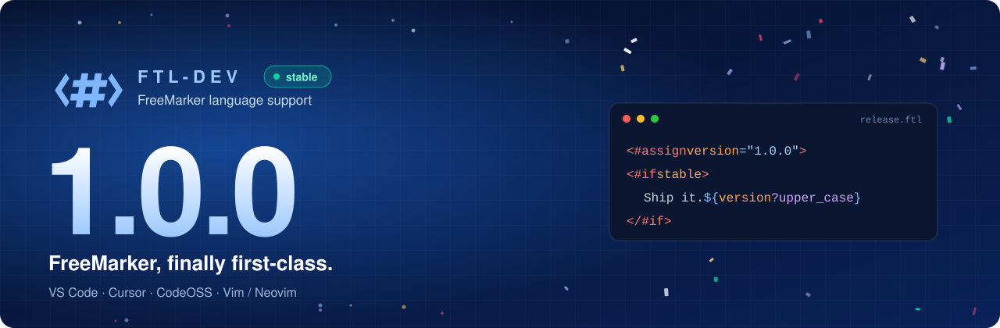

<p align="center">
  <a href="https://devnathan.github.io/ftl-dev/"></a>
</p>

<p align="center">

[](https://open-vsx.org/extension/nathan-0910/ftl-dev)
[](https://marketplace.visualstudio.com/items?itemName=nathan-0910.ftl-dev)
[](LICENSE)

</p>

# FTL-dev

> [!TIP]
> **1.0 나왔습니다.** 한동안 별 탈 없이 잘 굴러가서 이제 1.0 달아도 되겠다 싶었어요.
> 앞으로 익스텐션 ID, 언어 ID, 설정 키, `.ftl-data-model.json`은 메이저 버전 올릴 때만 바꿉니다([자세히](docs/versioning.ko.md)).
> [프로젝트 페이지](https://devnathan.github.io/ftl-dev/) · [변경 이력](extension/CHANGELOG.md)

> Canonical: [README.md](README.md) (English).

## 소개

FreeMarker(이하 ftl)가 개발 언어로 쓰일 수 있다는 사실, 알고 계셨나요? ftl은 빛보다 빠른 언어로(다소 많이 과장됨), 일반적인 개발 언어들보다는 확장성이 부족하지만 그렇다고 불충분하진 않습니다! 다만 어찌 됐건 사람들은 ftl을 잘 안 쓰는지, 쓸 만한 올인원 익스텐션은 없더군요.

그래서 만들었습니다. 이 익스텐션만 있으면 ftl로 개발하는 일이 좀 더 편해질 겁니다!

## 왜 쓰는가 / 무엇을 해결하는가

기존 ftl 익스텐션들은 부족한 점이 많습니다.

- 거지같이 보기 어렵거나 부적절한 신택스 하이라이팅
- 변수·함수 바로가기가 없어서 파일을 일일이 뒤져야 함
- 신택스 에러를 제대로 안 잡아 줌
- ftl 정석 문법을 따르지 않는 자동 들여쓰기

왜 이런 거지같은 것들을 지원 안 하는 걸까요? 아마 ftl을 안 써서겠죠 뭐.
불편하면 우물을 직접 파야죠! 이 익스텐션은 다음을 목표로 합니다.

- 적절한 신택스 하이라이팅으로 눈깔이 빠지지 않을 정도의 가독성
- Ctrl+클릭으로 변수·함수 선언부로 바로가기
- 고장 나기 전에 문법 오류를 잡아내기
- ftl 정석을 따르게 하는 자동 들여쓰기

## 주요 기능

- 신택스 하이라이팅 (`<#assign sql…>` 캡처 블록이나 `<#-- @lang sql -->` 표시 블록 안의 SQL 포함)
- 정의·import·경로로 이동·탐색
- 자동완성
- 디렉티브 닫기 · FTL식 들여쓰기
- 진단 · 시맨틱 토큰 · 아웃라인 · 참조 찾기
- (선택) 비교 연산자 표시 (`lt` / `gt` 등 → 기호처럼 보이게)

## 설치

할게 뭐 있겠습니까. VS Code나 CodeOSS 계열 마켓플레이스에서 익스텐션만 받으면 됩니다!

- Cursor / Open VSX · VS Code Marketplace: **FreeMarker (ftl-dev)** (`nathan-0910.ftl-dev`)
- 로컬이면 `cd extension && npm run package` 후 **Install from VSIX…**

[변경 이력은 여기서](extension/CHANGELOG.md).
영문은 제가 관리합니다만, 영어 다들 잘하시잖아요 그죠? :)

## 개발 (로컬)

```bash
cd extension && npm install && npm run compile
npm test
npm run package          # → ftl-dev-*.vsix
```

하고 나서 `Reload Window` 하는 거 잊지 마세요. fixture는 [`tests/fixtures/navigation/main.ftl`](tests/fixtures/navigation/main.ftl), 아니면 **F5**.

## 라이선스

이 프로젝트는 [Apache License 2.0](LICENSE) 아래에 있습니다.
마음껏 쓰되 [NOTICE](NOTICE)는 유지하고, 프로젝트 링크도 남겨 주세요: https://github.com/DevNathan/ftl-dev
