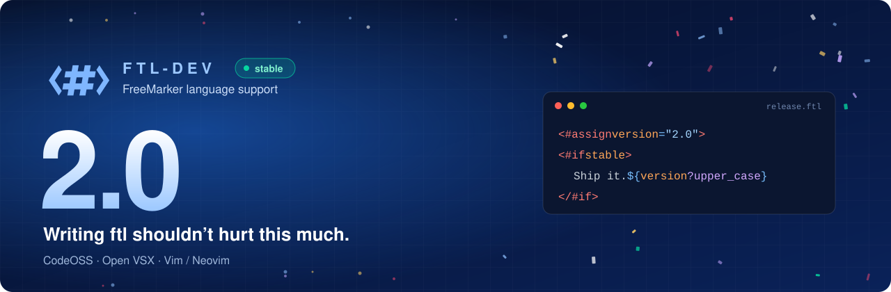

<p align="center">
  <a href="https://devnathan.github.io/ftl-dev/"></a>
</p>

<p align="center">

[](https://github.com/DevNathan/ftl-dev/releases)
[](LICENSE)

</p>

# FTL-dev

> [!TIP]
> **In 2.0:** hover import and include paths to read a template's ftldoc. The comparison operator display setting has been removed.
> [Project page](https://devnathan.github.io/ftl-dev/) · [Changelog](extension/CHANGELOG.md)

Did you know FreeMarker (ftl for short) can be used as a real programming language? ftl is faster than light (okay, heavily exaggerated), and while it is less extensible than mainstream languages, it is not exactly *insufficient*. Anyway, people barely use ftl, so of course there was no decent all-in-one extension.

So I built one. With this extension, working in ftl should hurt a little less.

## Why bother / what it fixes

Existing ftl extensions leave a lot to be desired.

- Syntax highlighting that is ugly as hell or just wrong
- No jump-to-definition for variables and functions—so you dig through files by hand
- Syntax errors that never get flagged
- Auto-indent that ignores how ftl is actually supposed to look

Why does nobody support this junk? Probably because nobody uses ftl.
If the well is dry, dig your own. This extension aims for:

- Highlighting readable enough that your eyeballs stay in your head
- Ctrl+click to jump to variable and function declarations
- Catching grammar mistakes before things blow up
- Auto-indent that follows ftl conventions

## Features

- Syntax highlighting, including SQL inside `<#assign sql…>` capture blocks or blocks marked `<#-- @lang sql -->`
- Go-to / navigate definitions, imports, and paths
- Completions
- Parameter hints for `#function` / `#macro` calls (Signature Help)
- Directive closing · FTL-aware indent
- Diagnostics · semantic tokens · outline · find references

## Install

- In a CodeOSS-family editor that uses [Open VSX](https://open-vsx.org/extension/nathan-0910/ftl-dev), search Extensions for `nathan-0910.ftl-dev`.
- For a manual install, download the VSIX from [GitHub Releases](https://github.com/DevNathan/ftl-dev/releases) and choose **Install from VSIX…**.
- ftl-dev is unavailable in Microsoft VS Code's Visual Studio Marketplace.

For a local build: `cd extension && npm run package`, then **Install from VSIX…**.

### Vim / Neovim

Separate repository: **[DevNathan/ftl-dev.vim](https://github.com/DevNathan/ftl-dev.vim)** (Pathogen / Vundle / vim-plug). Not developed or published from this VSIX tree. Capability matrix: [docs/product/vim-neovim-matrix.md](docs/product/vim-neovim-matrix.md).

[Changelog lives here](extension/CHANGELOG.md).
I keep it in English only—but you all read English fine, right? :)

## Skills for coding agents

### FTL writing

Add the [FTL writing skill](skills/ftl-writing/SKILL.md) from your project's terminal:

```sh
npx skills add https://github.com/DevNathan/ftl-dev --skill ftl-writing
```

It shows the agent when to use bracket slices and hash lookups, and when to keep code together or split it into macros, functions, and files. The skill can be installed independently of the editor extension.

### ftldoc

Add the [ftldoc skill](skills/ftldoc/SKILL.md) to document template files, macros, and functions with the comments ftl-dev shows in the editor.

```sh
npx skills add https://github.com/DevNathan/ftl-dev --skill ftldoc
```

## Develop (local)

```bash
cd extension && npm install && npm run compile
npm test
npm run package          # → ftl-dev-*.vsix
```

Do not forget `Reload Window` afterward. Try [`tests/fixtures/navigation/main.ftl`](tests/fixtures/navigation/main.ftl), or just hit **F5**.

## License

This project is under [Apache License 2.0](LICENSE).
Use it freely, keep the [NOTICE](NOTICE), and leave a link to the project: https://github.com/DevNathan/ftl-dev

## Language

Canonical docs are **English**. Optional Korean: [README.ko.md](README.ko.md) (`*.ko.md`).
