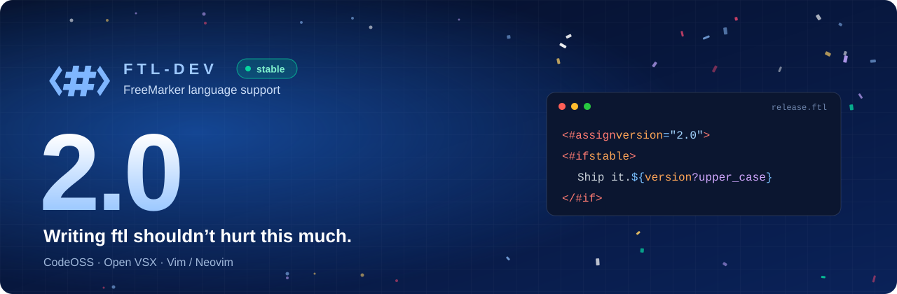

<p align="center">
  <a href="https://devnathan.github.io/ftl-dev/"></a>
</p>

# FTL-dev

> **In 2.0:** template paths show file ftldoc on hover. The comparison operator display setting has been removed. [Project page](https://devnathan.github.io/ftl-dev/) · [Changelog](CHANGELOG.md)

Did you know FreeMarker (ftl for short) can be used as a real programming language? ftl is faster than light (okay, heavily exaggerated), and while it is less extensible than mainstream languages, it is not exactly *insufficient*. Anyway, people barely use ftl, so of course there was no decent all-in-one extension.

So I built one. With this extension, working in ftl should hurt a little less.

## Why bother / what it fixes

Existing ftl extensions leave a lot to be desired.

- Syntax highlighting that is ugly as hell or just wrong
- No jump-to-definition for variables and functions—so you dig through files by hand
- Syntax errors that never get flagged
- Auto-indent that ignores how ftl is actually supposed to look

Why does nobody support this junk? Probably because nobody uses ftl.
If the well is dry, dig your own. This extension aims for:

- Highlighting readable enough that your eyeballs stay in your head
- Ctrl+click to jump to variable and function declarations
- Catching grammar mistakes before things blow up
- Auto-indent that follows ftl conventions

## Features

- Syntax highlighting, including SQL inside `<#assign sql…>` capture blocks or blocks marked `<#-- @lang sql -->`
- Go-to / navigate definitions, imports, and paths
- Completions
- Directive closing · FTL-aware indent
- Linked editing of open/close tag names (`<#if>` ↔ `</#if>`, `<@m>` ↔ `</@m>`)
- Diagnostics · semantic tokens · outline · find references
- ftldoc doc comments (Javadoc / JSDoc style: `@param {type} [name=default]`, multi-line `@return`, `@example`, `@note`, custom `@tag`, `{@link}` / `{@code}`) in Hover, Signature Help and completion
- File ftldoc (`@file`) when hovering a literal path in `#import` or `#include`

### File documentation

Put a FreeMarker comment at the top of the target template, immediately after the `#ftl` header if the file has one. Start the comment with `@file`, then write its description on the same line or below it. Both `<#-- … -->` and `[#-- … --]` work.

```ftl
<#--
  @file Renders the account header.
  @requires `account.displayName` in the template data model.
  @usage Include this file where the header should appear.
  @example <#include "account-header.ftl">
-->
```

Use `@requires` for data or dependencies, `@exports` for public macros and functions, and `@usage` for how to call or include the file. Existing ftldoc tags such as `@example`, `@note`, `@see`, and `@since` work here too. A comment starting with `@nodoc` stays hidden. Hover the quoted path in the calling template to read the target's documentation.

## Install

- In a CodeOSS-family editor that uses [Open VSX](https://open-vsx.org/extension/nathan-0910/ftl-dev), search Extensions for `nathan-0910.ftl-dev`.
- For a manual install, download the VSIX from [GitHub Releases](https://github.com/DevNathan/ftl-dev/releases) and choose **Install from VSIX…**.
- ftl-dev is unavailable in Microsoft VS Code's Visual Studio Marketplace.

For a local build: `npm run package`, then **Install from VSIX…**.

[Changelog lives here](CHANGELOG.md).
I keep it in English only—but you all read English fine, right? :)

## Develop (local)

From the `extension/` directory in the [repo](https://github.com/DevNathan/ftl-dev):

```bash
npm install && npm run compile
npm test
npm run package          # → ftl-dev-*.vsix
```

Do not forget `Reload Window` afterward. Try [tests/fixtures/navigation/main.ftl](https://github.com/DevNathan/ftl-dev/blob/main/tests/fixtures/navigation/main.ftl), or just hit **F5**.

## License

This project is under [Apache License 2.0](LICENSE).
Use it freely, keep the [NOTICE](NOTICE), and leave a link to the project: https://github.com/DevNathan/ftl-dev

## Language

Canonical docs are **English**. Optional Korean: [README.ko.md](https://github.com/DevNathan/ftl-dev/blob/main/README.ko.md) (`*.ko.md`).
